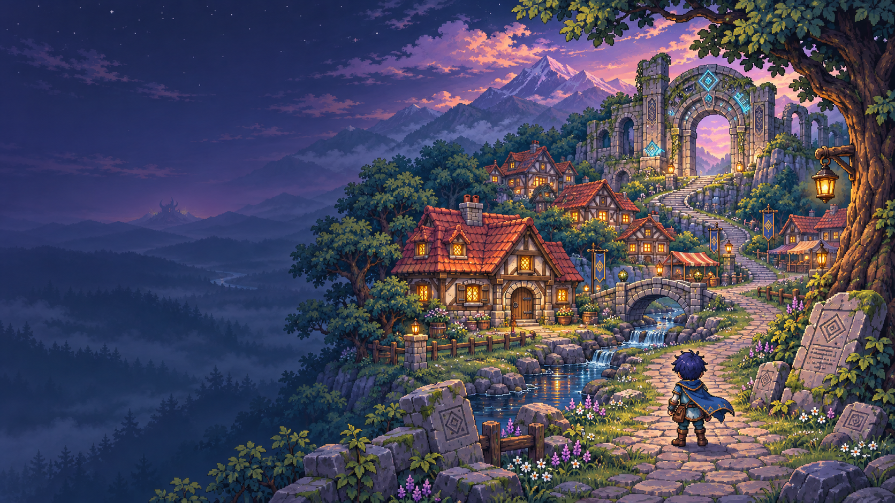

# CodeChronicle ― コードの扉を開く者達



失われたコードの知識を、冒険の中で取り戻す。React・Vue・Laravelを学ぶ、PCブラウザ向けの2D RPGです。ゲーム本体はReact・TypeScript・Viteで制作しています。

SFC時代のRPGが大好きで、画面や操作の雰囲気を参考にしています。町の灯り、ドット絵の人物、会話の窓、キーボードで進める操作など、冒険したくなる世界を少しずつ作っています。

## 今すぐ遊ぶ

**▶ [CodeChronicleを遊ぶ（Cloudflare版・おすすめ）](https://codechronicle-staging.metappi-dev.workers.dev/)**

- 予備の公開先：[GitHub Pages版](https://zundabyon.github.io/CodeChronicle/)（問題はゲームに同梱した版を使います）
- PCのブラウザで遊べます。インストールや登録は不要です。
- 冒険はブラウザに自動保存されます。

## いまの仕様（2026年11月13日時点）

| 項目 | 内容 |
| --- | --- |
| 学べること | React・Vue（TypeScript）、Laravel、Inertia連携とLaravel API連携、HTTP・CRUDの基礎 |
| 学習の設定 | 難易度（初級・中級・上級）、フロントエンド（React／Vue）、Inertia環境のオン・オフをいつでも切り替え可能 |
| 問題数 | 全438問。通常の敵との戦闘では、設定に合う問題から未回答のものを優先してランダムに出題 |
| 問題の形式 | 4択、コード穴埋め（選択・入力）、ゲーム内CLI（ボス戦） |
| 間違えたとき | 正解の解説に加え、多くの問題では「選んだ選択肢がなぜ違うか」も表示 |
| 物語 | 第一章（育ての親を救うため遺跡の扉を開く）、第二章「消えた名簿」（CRUDの4ダンジョンと掲示板の総合実習） |
| 振り返り | 教会の「復習の部屋」で間違えた問題に再挑戦、学習記録、会話の履歴、本棚の読書 |
| ダンジョンの便利機能 | 無料の回復泉、封印を解いた部屋から村へ戻る帰還点、入口から一番奥の部屋へ戻る帰還点 |
| 操作 | 矢印キー・WASD・クリックで移動、Enterで会話・調査、F1で操作方法 |
| セーブ | ブラウザに自動保存。別の端末へはタイトルの「冒険の管理」から書き出し・取り込み（クラウドセーブは未対応） |

### 制作中

- 第二章を「読む・増やす・直す・消す」の4幕に再構成し、村を襲う敵役との戦いと、ダンジョン内の解説を追加します。
- 各ダンジョンを、部屋ごとに形の違う入り組んだ構造に作り直します。

## どんなゲーム？

- 町やダンジョンを探索し、住人との会話・本・戦闘を通して学びます。
- 問題は4択・コード穴埋め（選択／入力）・ゲーム内CLI。ボス戦では症状とログから復旧操作を考えます。実際のコマンドは実行しません。
- 第二章はCRUDの4ダンジョン。封印の問いを解いて扉を開き、記憶の欠片を集めながらLaravelリソースコントローラの7つの役割を学び、掲示板の総合実習へ進みます。途中には回復の泉や冒険者もいます。
- 教会の「復習の部屋」で間違えた問題に再挑戦。学習記録から振り返れます。

移動は矢印キー・WASD・クリック、会話や調査はEnter。詳しい操作はゲーム内の「操作方法」（F1）へ。

### 第二章：四つのダンジョンと七つの役割

「消えた名簿」を取り戻すため、C・R・U・Dの記憶の欠片を集めます。「画面を表示すること」と「DBを書き換えること」を区別し、目的に合う操作を考える構成です。

| 記憶 | ダンジョン | 学ぶ役割 |
| --- | --- | --- |
| C：作成 | 創生の工房 | `create` / `store` |
| R：読取 | 読解の書庫 | `index` / `show` |
| U：更新 | 改変の回廊 | `edit` / `update` |
| D：削除 | 忘却の墓所 | `destroy` |

4ダンジョンの44問と掲示板の総合実習7問、計51問。各部屋の実習を終えると封印扉が開きます。泉で休み、冒険者の話を聞きながら進められ、任意の敵との戦闘ではその土地の操作を復習できます。

詳しくは[第二章の教材とダンジョン設計](docs/chapter-two-learning.md)へ。

### 問題づくりのこだわり

入力問題は短い識別子やキーワードを中心にし、許容する別解を明示します。誤答には同じ分野で起きやすい取り違えを使い、解説で振り返れるようにしています。

難易度の目安は、初級＝基本動作、中級＝コードの判断、上級＝条件とトレードオフ。回答後の解説、本の確認問題、教会での復習をつなげ、間違えた後にも学べるようにしています。

## ローカルで起動

Node.js・npmが必要です（CIはNode.js 22系）。まずは通常版から。

```bash
npm ci
npm run dev
```

表示されたURLをブラウザで開きます。通常版はコードに同梱した問題を使います。

Cloudflare Workers・D1の接続をローカルで試す場合は、依存関係のインストール後にこちら。

```bash
npm run dev:staging
```

問題集の生成・ビルド → ローカルDBの準備・問題投入 → Wrangler起動をまとめて実行します。起動中のサーバーはCtrl+Cで止めてから実行してください。

## 構成と制作ルール

地図・素材・人物・物語・学習・戦闘・画面・音・保存を、9ジャンルの制作ルールで整理しています。共通仕様と対象ごとの設定・制作履歴を分け、素材や手順を使い回せる構成を目指しています。

| 場所                        | 役割                                            |
| ------------------------- | --------------------------------------------- |
| `src/`                    | ゲーム画面・進行・採点。`world/`に地図・素材定義、`quests/`に依頼・第二章 |
| `public/`                 | 画像・フォントなどの素材                                  |
| `worker/`・`migrations/`   | 問題を配信する読取APIとD1のDB定義                          |
| `scripts/`・`tests/`       | 問題集の書き出し・ファイル台帳・検証                            |
| `docs/`・`.agents/skills/` | 設計・制作ルール・学習資料・エージェントの作業手順                     |

地形・建物・小物・キャラクターは、素材の定義とマップへの配置を分離。画像を複製せず同じ素材を使い回し、見た目・通行判定・会話や調査の動作をそれぞれ管理します。

Orcaで地図・人物・操作などの担当を分けながら開発しています。制作手順をSkillにまとめ、誰が担当しても共通ルールと固有設定を辿れるようにしています。

| Skill | 担当 |
| --- | --- |
| `project-guide` | 9ジャンルの制作ルールと追加・変更先の案内 |
| `game-art` | 共通仕様と個別設定に沿った画像制作・品質確認 |
| `question-author` | 問題形式・正答・誤答・入力の公平さ・難易度 |
| `code-review` | 別エージェントによる独立レビューと相互検証 |

画像は「会話用」「歩行」「戦闘用」など用途別に仕様を共通化し、人物ごとの外見は個別設定に分けます。構想や仕様の壁打ちには円卓スキルを使い、肯定・中立・否定・ユーザーの立場から検討しています。

- [制作の入口：9ジャンルと共通仕様](docs/production/index.md)
- [美術・素材の品質基準](docs/art-direction.md) ／ [問題の形式・採点・作問ルール](.agents/skills/question-author/SKILL.md)
- [Cloudflare移管のHTML教科書](docs/learning/cloudflare-deployment-textbook.html) ／ [現在の実装状況・実行手順](docs/learning/cloudflare-api-progress.md)
- [全ファイルの分類台帳](docs/architecture/file-inventory.json)

## 検証

```bash
npm test                 # ゲームルール・保存・問題・API
npm run build            # 型チェックと通常版ビルド
npm run check:worker     # Workerの型チェック
npm run test:e2e         # ブラウザでの動作確認（Chrome等が必要）
```

素材の検査は`npm run check:art`、ファイル台帳の更新・確認は`node scripts/production-inventory.mjs --write`／`--check`。

## 保存と公開状況

ゲーム画面はReact・TypeScript、試験用の読取APIはCloudflare Workers、問題の配信先はD1です。Laravelは学習する題材で、ゲーム本体がPHPサーバー上で動く構成ではありません。

冒険はブラウザの`localStorage`へ自動保存します。クラウドセーブ・端末同期は未対応です。別のURLや端末へ移るときは、タイトルの「冒険の管理」からJSONを書き出し・取り込みして引き継ぎます。

公開先は[Cloudflare版](https://codechronicle-staging.metappi-dev.workers.dev/)。438問をD1から取得します。問題の制作原稿はGitで管理し、D1を配信先として使います。

`main`へのpushで[Cloudflare CI/CD](.github/workflows/deploy-cloudflare.yml)がテスト・型チェック・タイトルのブラウザ検証を実行し、成功後に問題集生成 → D1更新 → サイト公開 → 配信ファイル・問題集の照合まで進みます。PRでは検証のみ。初回はGitHubのActions secretsに`CLOUDFLARE_API_TOKEN`の登録が必要です（[設定手順](docs/learning/cloudflare-cicd.md)）。GitHub Pagesの既存公開も継続しますが、D1を使う公開先はCloudflare版です。

D1版は起動時に必要な問題集をまとめて読み込み、版・問題ID・形式を検証してから冒険を開始します。取得に失敗した場合は、セーブを変更せず再試行できる画面を表示します。

## これから

問題と物語を増やしながら、Cloudflareへの移管も進めています。将来は、冒険を通して簡単な掲示板アプリを作れる力を身につけ、魔王戦へ進めるゲームにしたいと考えています。
